  

  
  
  

### `$ whoami`

MSc Cybersecurity with AI student at the University of Lancashire and Hack The Box CJCA certified. I'm working toward CPTS and OSCP+, and I build AI red team and defensive tooling to learn with, then take it apart line by line.

**Goal:** senior pentester or senior AI security engineer.

### `$ ls ~/projects`

| Project | What it does | Stack |
|---|---|---|
| **Shadowfax** | Security ops platform that treats AI agents as first-class identities. Detection stays deterministic; LLMs only explain. | Python · FastAPI · SQLite · React |
| **maltriage** | Static malware triage: hashes, format ID, streaming entropy, severity-ranked JSON findings. | Python · pytest |
| **claude-recon-agent** | AI study agent: recon on the red side, log hunting on the blue side, mapped to MITRE ATT&CK, with a fail-closed scope check. | Python · Claude API |
| **ShadowClip** | Kali clipboard manager with pinning, search and a secret filter. History lives in tmpfs. | Bash · GTK3 · systemd |
| **ShadowSnip** | Snipping Tool style capture that copies a compressed image the moment a snip ends. | Python · Windows |

### `$ cat now.txt`

- Studying for the MSc and preparing for HTB CPTS
- Writing maltriage v0.2 (PE parsing) from scratch
- Thirty minutes of Python every day

All testing is done on systems I'm authorized to test: HTB, THM and my own lab.
