<a href="https://jh-infosec.github.io"></a>

<a href="https://jh-infosec.github.io"></a>

<a href="https://github.com/jh-infosec/Shadowfax"></a>

<a href="https://github.com/jh-infosec/Maltriage"></a>
<a href="https://github.com/jh-infosec/AI-Recon-Agent"></a>

<a href="https://github.com/jh-infosec/ShadowSnip"></a>
<a href="https://github.com/jh-infosec/ShadowClip"></a>

<a href="https://github.com/jh-infosec/HTB-Writeups"></a>
<a href="https://jh-infosec.github.io"></a>

<a href="https://jh-infosec.github.io/#focus"></a>

<a href="https://jh-infosec.github.io/#journey"></a>

<a href="https://jh-infosec.github.io/#contact"></a>
